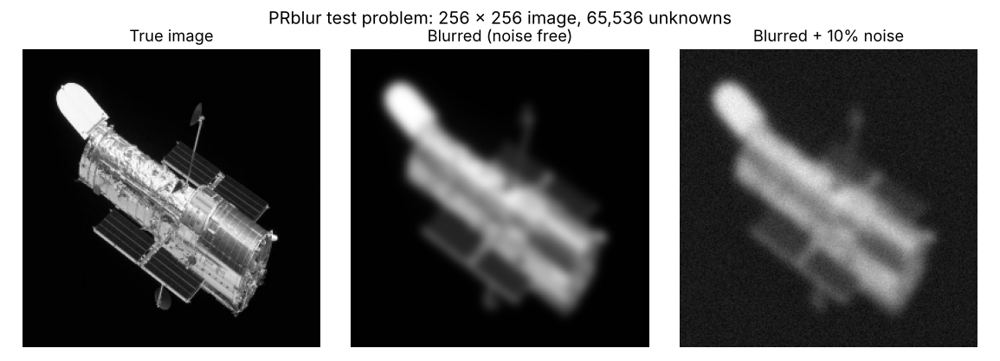
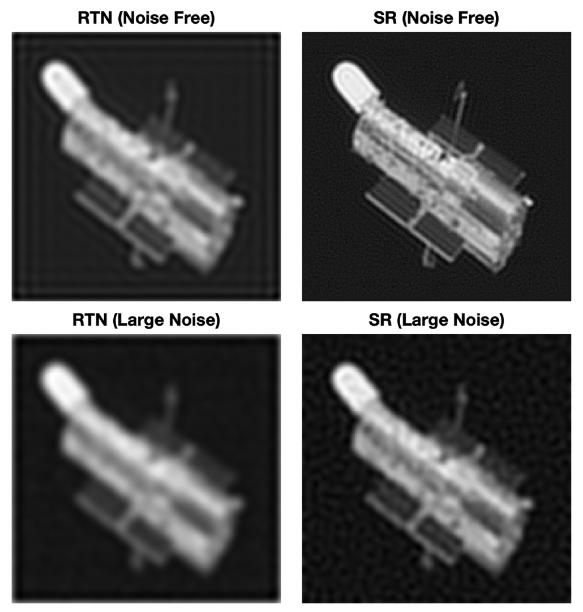
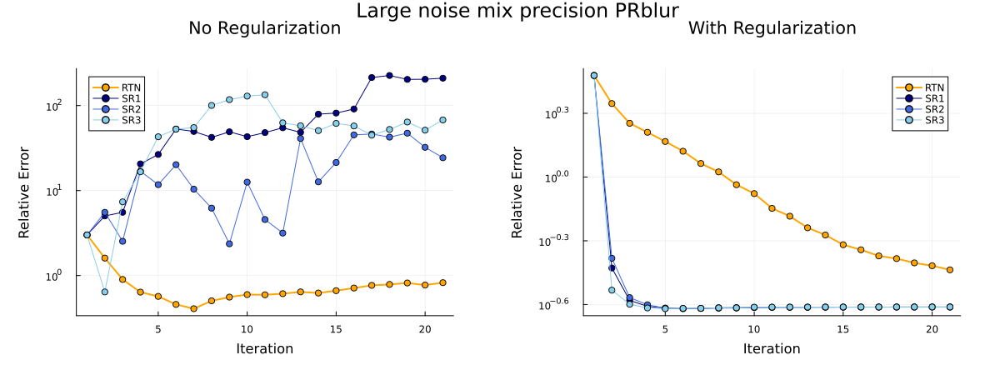
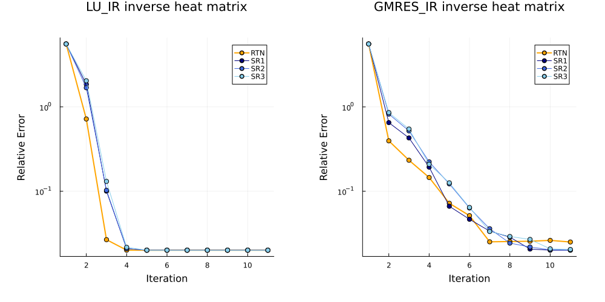

# Stochastic Rounding in Mixed-Precision Iterative Refinement


Code and results for my honors thesis at Emory University (Department of Mathematics, advisor Dr. James Nagy), awarded **Highest Honors in Mathematics**.

📄 **[Read the full thesis (PDF)](YIFEI_GUAN_SRmixIR.pdf)**

**Question:** low-precision arithmetic (Float16) is fast and memory-cheap, but on ill-conditioned problems iterative refinement often *stagnates*: rounding errors stop the solution from improving. Can **stochastic rounding** (rounding up or down at random, in proportion to distance) remove that stagnation and recover high-precision accuracy?

**Answer, on a 65,536-unknown image-deblurring problem:** with Tikhonov regularization, Float16 stochastic rounding reached the same accuracy as full Float64 at every noise level tested. Round-to-nearest in the same mixed-precision setup stalled at an error 50–70% higher.

## Key results



**PRblur deblurring (A = A₁ ⊗ A₂, 256 × 256 image).** Minimum relative error with Tikhonov regularization (λ = 0.06), mixed-precision GMRES-IR (low Float16, working Float32, residual Float64), 20 refinement steps:

| Noise level | Float64 baseline | Mixed precision, round-to-nearest | Mixed precision, stochastic rounding (3 runs) |
| --- | --- | --- | --- |
| None | 0.218 | 0.352 | 0.218 / 0.218 / 0.218 |
| 0.1% | 0.218 | 0.367 | 0.218 / 0.218 / 0.218 |
| 1% | 0.218 | 0.372 | 0.218 / 0.218 / 0.218 |
| 10% | 0.240 | 0.366 | 0.240 / 0.241 / 0.240 (within 4–5 steps) |

<p align="center"></p>

*Restored images (thesis Figure 5.11). With stochastic rounding, the noise-free restoration recovers fine detail on the telescope body that round-to-nearest leaves blurred.*



*10% noise. Right: with regularization, the three SR runs (blue) converge in about 4 steps while round-to-nearest (orange) is still improving slowly after 20. Left: without regularization the noise is amplified and SR runs diverge, which is why regularization matters.*

**Inverse heat problem (n = 256, condition number 1.2 × 10¹⁸, about 400 after regularization).** LU-IR with RTN and SR both reach a relative error of 0.020. With GMRES-IR, SR reaches 0.020–0.0204 while RTN stops at 0.025.



**What it costs:** Julia has no hardware stochastic rounding, so `Float16sr` is emulated in software. SR runs took about 168 s against about 9 s for RTN on the regularized PRblur problem. The accuracy result is the point here; the speed would come from hardware that supports SR natively.

## How it works

Mixed-precision iterative refinement uses three precisions in each step:

1. **Residual** r = b − A x in high precision (Float64)
2. **Correction** solve A d = r in low precision (Float16): either LU, or GMRES on the matrix-free operator
3. **Update** x ← x + d in working precision (Float32)

Stochastic rounding is applied whenever values are cast to Float16 (the matrix and each residual), using [StochasticRounding.jl](https://github.com/milankl/StochasticRounding.jl).

For the image problem, the 65,536 × 65,536 blur matrix is never formed. A Julia port of the MATLAB `KronMatrix2` class stores only the two 256 × 256 factors, and products use (A₁ ⊗ A₂) vec(X) = vec(A₂ X A₁ᵀ). That is what made the large experiments feasible.

## Run it

Requires Julia (1.9 or newer recommended).

```bash
git clone https://github.com/WallGuan/SR_mixIR.git
cd SR_mixIR
julia setup.jl                         # one time: creates the environment and installs packages
cd Main
julia --project=.. kron_problem.jl     # PRblur experiments  -> single_error.png, mix_error.png
julia --project=.. heat_problem.jl     # inverse heat problem -> inverse_heat.png
julia --project=.. blur_mat.jl         # saves restored images as .mat files for MATLAB display
```

In `kron_problem.jl`, choose the noise level by uncommenting one `bnoise(...)` line (all commented = noise free). The runs in `logs_graphs/` were made on the CPU nodes of Emory's H100 cluster (ADA); `Float16sr` is not CUDA-compatible.

## Repository structure

```
SR_mixIR/
├── Main/                          # everything used for the thesis results
│   ├── refinement_funcs.jl        # IR_fact (LU-IR), IR_GMRES, IR_kronreg (Tikhonov), GMRES solvers
│   ├── other_funcs.jl             # heat test problem, augmented system, noise, plotting helpers
│   ├── kron_problem.jl            # PRblur experiments (uniform vs mixed precision, RTN vs SR)
│   ├── heat_problem.jl            # inverse heat experiments (LU-IR and GMRES-IR)
│   ├── blur_mat.jl                # exports restored images to .mat
│   ├── PRblurData_new.mat         # Kronecker factors A1, A2, blurred image btrue, true image xtrue
│   ├── kronecker/                 # KronMatrix2 type: *, \, transpose, LU, SVD on the factors
│   └── logs_graphs/               # console logs and plots for every experiment
├── KroneckerProductTools_matlab/  # original MATLAB KronMatrix2 class (reference for the port)
├── Other_Julia_code/              # early experiments and notebooks (not part of the final results)
├── assets/                        # README figures
├── YIFEI_GUAN_SRmixIR.pdf         # the full honors thesis
├── Project.toml                   # Julia environment (package list)
└── setup.jl                       # installs the Julia dependencies
```

**Reading the logs and plots.** Each error history starts with the initial guess, so "minimum at iteration k" in the logs means k − 1 refinement steps, and the plots' x-axis is shifted by one.

## Code notes

- **Tikhonov regularization** is applied through the augmented system [I A; Aᵀ −λ²I][r; x] = [b; 0], computed matrix-free so the Kronecker structure is kept.
- **Update after the thesis:** `IR_kronreg` now keeps λ in high precision for the residual and rounds it only for the low-precision solve. In the thesis runs, the rounded λ also leaked into later residuals. The effect is small (λ in Float16 differs by about 0.03%), but re-running may not match `logs_graphs/` digit for digit.
- `heat()` uses a slightly different quadrature grid than Hansen's Regularization Tools (see its docstring). It is kept as is so results stay reproducible.

## References

- E. Carson and N. J. Higham, *Accelerating the solution of linear systems by iterative refinement in three precisions*, SIAM J. Sci. Comput., 2018.
- M. Croci, M. Fasi, N. J. Higham, T. Mary and M. Mikaitis, *Stochastic rounding: implementation, error analysis and applications*, Royal Society Open Science, 2022.
- J. Kamm and J. G. Nagy, *Kronecker product and SVD approximations in image restoration*, Linear Algebra Appl., 1998.
- P. C. Hansen, *Regularization Tools* (the `heat` test problem); S. Gazzola, P. C. Hansen and J. G. Nagy, *IR Tools* (the `PRblur` test problem).
- M. Klöwer, [StochasticRounding.jl](https://github.com/milankl/StochasticRounding.jl).

## Author

**Yifei (Mary) Guan**, Harvard MS in Data Science (2028), BS Applied Mathematics & Statistics, Emory University (2026).
